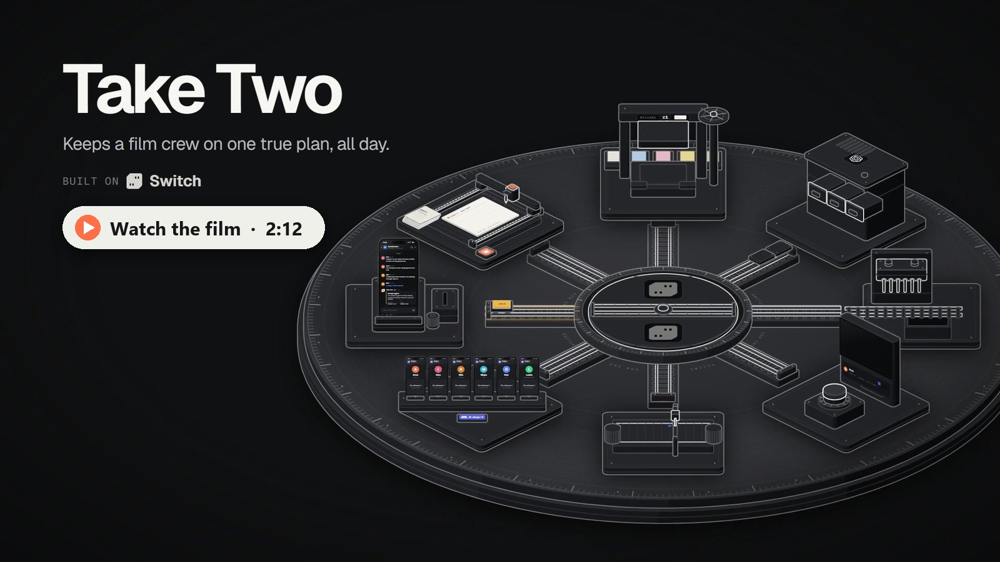
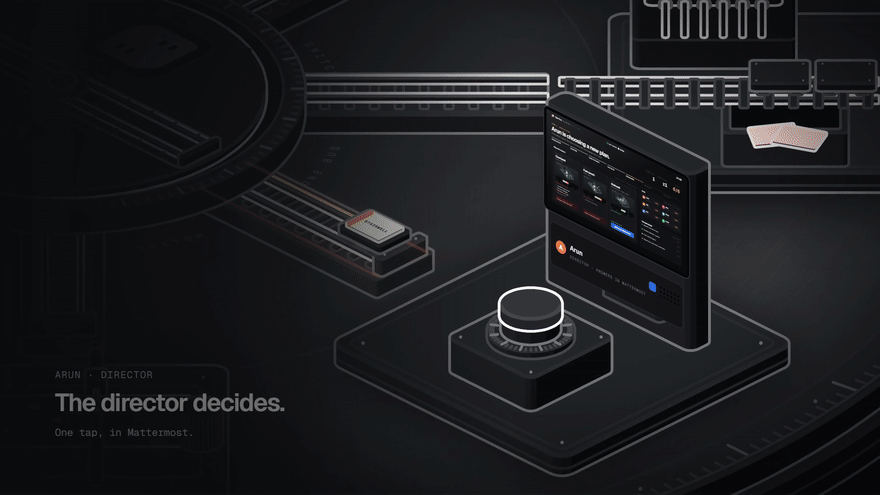
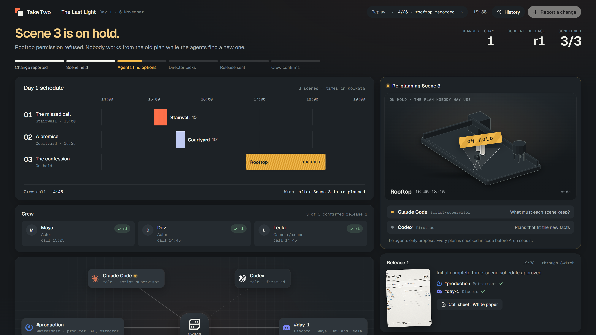
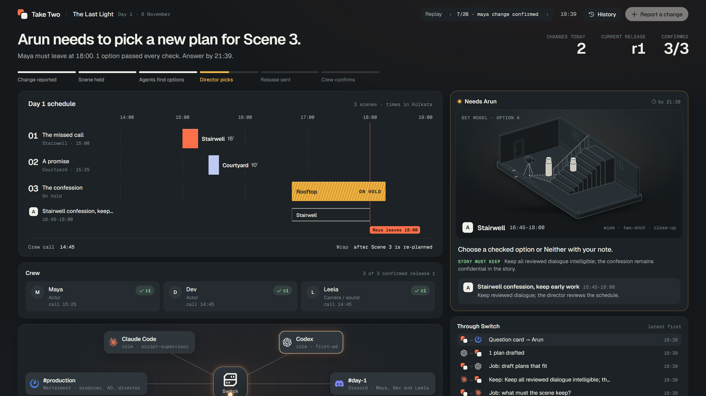
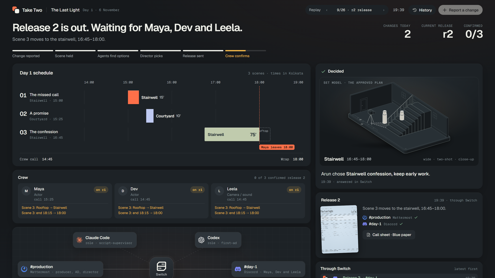
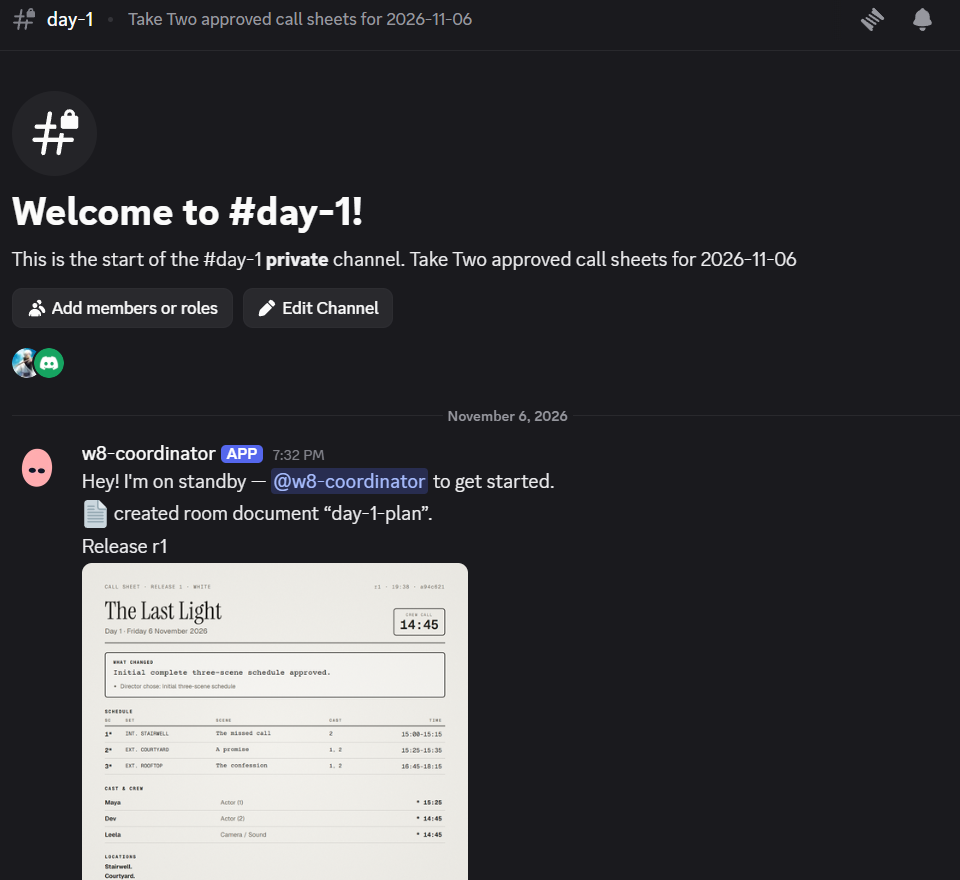
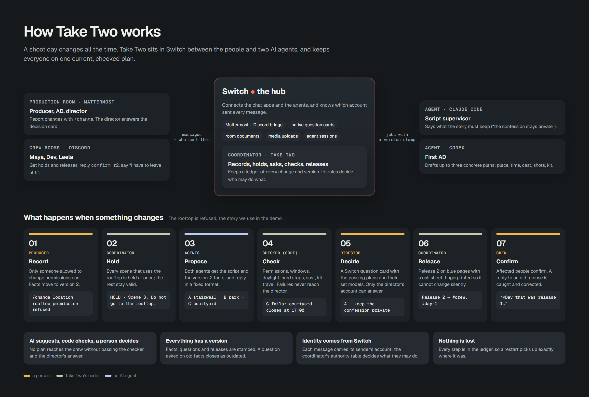
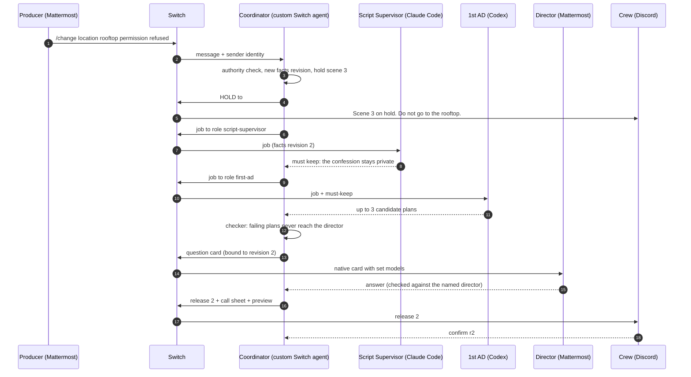

<div align="center">

# Take Two

**Keeps a film crew on one true plan, all day.**

Agents propose. Code checks. People decide. Every message goes through [Switch](https://github.com/sandbox-quantum/switch).

[](https://github.com/sandbox-quantum/switch)
[](https://www.wemakedevs.org/hackathons/switch)


<a href="https://github.com/MokiMeow/take-two/releases/download/v1.0/take-two-film.mp4">
  
</a>

**[Watch the 2-minute film](https://github.com/MokiMeow/take-two/releases/download/v1.0/take-two-film.mp4)** · [How it works](#how-it-works) · [How Switch is used](#how-switch-is-used) · [Run it in 5 minutes](#run-it)

</div>

---

## The problem

On a shoot day the plan changes all day. A location says no at the last minute, an actor is 40 minutes late, the sound recorder dies, a scene runs over. Each change ripples: new call times, a different location, fewer shots, people who must now leave earlier.

On small crews this happens in a group chat. Someone posts a new plan, someone else replies to the old one, half the crew drives to the rooftop that just refused, and nobody can say who has actually seen the current version. The plan exists in five versions on six phones.

## What Take Two does

Take Two is a production room built on Switch. When something changes, it:

1. **Records** the change, but only from the person allowed to make it (only the producer can say a location refused).
2. **Holds** every scene the change breaks, at once, in every room. Nobody shoots the old plan.
3. **Asks two AI agents** for new plans, by role: a **Script Supervisor** (Claude Code) says what the scene must keep for the story, then a **1st AD** (Codex) drafts up to three concrete plans.
4. **Checks** every plan in plain code: permissions, light, hard stops, cast, kit, travel. A plan that fails never reaches a person.
5. **Lets the director decide** on a native Switch question card, with a set model of each option. A card asked on old facts closes itself.
6. **Releases** one versioned, fingerprinted call sheet to the production room and the crew's Discord.
7. **Tracks confirmations** from each affected person. A reply about an old release is caught and corrected.

The agents never decide and never publish. A person always chooses, and the plan that reaches the crew is always one that passed the checks.

<p align="center">
  
</p>

## See it

**Scene 3 is held** the moment the rooftop refuses. Both agents get their jobs through Switch.



**The director picks.** Only plans that passed every check reach him, each with a set model of where people and the camera stand. Maya's 18:00 hard stop is drawn on the schedule.



**Release 2 goes out** to `#production` (Mattermost) and `#day-1` (Discord) through Switch, on blue revision paper, and waits for the three people whose day changed.



<details>
<summary><b>The real Discord room</b>: the coordinator posting releases into <code>#day-1</code> through the Switch Discord bridge</summary>
<br>

</details>

## How it works





## How Switch is used

Take Two cannot run without Switch. Every person, every agent and every message goes through it; the coordinator has no other channel to anyone.

| Switch feature | What Take Two does with it | Code |
|---|---|---|
| **Custom agent registration** (`POST /agents`) and the live **WebSocket** connection | The coordinator is its own Switch agent, registered once with a personal key, so the user owns it. It reads every room event and answers server pings. | [`switch_client.py`](coordinator/switch_client.py) `initialize`, `events` |
| **Rooms and bridges** | `#production` lives in Mattermost (Switch's local server). `#day-1` lives in Discord through the Switch Discord bridge, created from a YAML room template. | [`templates/`](templates), `create_room_from_yaml` |
| **Sender identity** | Each message carries its sender's account. The coordinator's authority table decides who may change what: only the producer can refuse a location, only the AD can confirm a late actor, only the director's answer releases a plan. | [`workflow_models.py`](coordinator/workflow_models.py), [`runtime.py`](coordinator/runtime.py) |
| **Exclusive roles** (`assume_role`, `target_roles`) | Two separate agent identities hold `script-supervisor` and `first-ad`. Jobs are addressed to the role, not the agent, and missing holders are reported, never skipped. | `send_role_message` |
| **Native question cards** (session approvals) | The director chooses between checked plans on a Switch card. Each card is bound to the facts revision it was asked on; a newer change closes it as outdated. Crew members confirm their new duties on cards too. | `open_question`, `get_outcomes`, `close_question`, [`cards.py`](coordinator/cards.py) |
| **Room documents** | `script-r1` and `constraints-rN` are versioned room documents the agents load with `load_internal_documents`. | `create_room_document`, `update_room_document` |
| **Media uploads** | Each option's set-model preview (MP4) and each release's call sheet (PNG) are uploaded to the rooms through Switch, which hands them to Mattermost and Discord natively. | `send_media` |
| **Console-managed agents** | The two reasoning agents are Claude Code and Codex sessions created by Switch Console from [`agents/team.template.yaml`](agents/team.template.yaml). | [`agents/`](agents) |

## Agents connected

| Agent | Runs as | Job | Never |
|---|---|---|---|
| **Script Supervisor** | Claude Code, managed by Switch Console, role `script-supervisor` | Says what each scene must keep for the story ("the confession stays private"). | Picks a plan or edits documents |
| **1st AD** | Codex, managed by Switch Console, role `first-ad` | Drafts up to three concrete plans: location, times, cast, shots, kit. | Marks a plan feasible |
| **Coordinator** | Python (this repo), a custom Switch agent. No LLM. | Records changes, holds scenes, sends jobs, runs the checker, opens cards, releases, tracks confirmations. | Guesses from free text: unstructured reports wait for a human to confirm |

Both agent briefs, with their exact JSON reply formats, are in [`agents/`](agents). The deterministic checker is [`coordinator/checker.py`](coordinator/checker.py).

## How the rooms are set up

| Room | Where | Who |
|---|---|---|
| `#production` | Mattermost, from the Switch local server | Producer, AD, director, both agents, the coordinator |
| `#day-1` | Discord, through the Switch Discord bridge | Maya, Dev, Leela (the crew) and the coordinator |

Only approved plans and holds ever reach the crew room. Options, arguments and agent replies stay in `#production`. Setup steps for the Discord bot and the Console agents: [`docs/SETUP.md`](docs/SETUP.md).

## Run it

Full instructions: **[QUICKSTART.md](QUICKSTART.md)**.

**1. Replay the recorded shoot day** (Node 24, about 5 minutes, nothing else needed)

```bash
npm ci --prefix ui
npm run dev --prefix ui
# open http://localhost:5173/?fixtures=day and step with the arrow keys
```

The Control Room replays the 26 recorded moments of a day where four things go wrong.

**2. Run the real loop on your own Switch** (Docker, uv, a Switch checkout)

```powershell
$env:SWITCH_SOURCE = 'C:/path/to/switch'      # checkout at 989225d8
uv sync --locked
./scripts/switch/start.ps1                     # Switch + Mattermost + gateway
uv run python -m scripts.judge_credentials     # local registration key, never printed
uv run --env-file data/judge.env python -m scripts.demo_day
uv run python -m scripts.serve_demo --settings data/w8-demo/settings.json
# Control Room: http://127.0.0.1:8787   Mattermost: http://127.0.0.1:8065
```

`demo_day` drives the whole day against the real Switch server: real role messages, real question cards and answers, real renders and uploads.

**Tests:** `uv run pytest -q` (320 tests, Python 3.12). UI: `npm run lint --prefix ui && npm run build --prefix ui`.

## The recorded day

| # | What goes wrong | Reported by | What Take Two does | Release |
|---|---|---|---|---|
| 1 | The rooftop refuses permission, then Maya says she must leave at 6 | Producer, Maya (confirmed by the AD) | Holds scene 3, closes the card asked on old facts, moves the confession to the stairwell before 18:00 | r2 (blue) |
| 2 | Dev is 40 minutes late | Dev (confirmed by the AD) | Holds scenes 1 and 2, one plan moves both | r3 (pink) |
| 3 | The sound recorder dies | AD | Holds every scene that needs it, switches to the confirmed lav mic; only Leela's duties changed, so only Leela re-confirms | r4 (yellow) |
| 4 | Scene 1 runs 25 minutes over | AD | Records the overrun, slides scene 2 and the call times after it | r5 (green) |

Five versioned releases, 13 question cards answered, 10 crew confirmations, 0 people left on an old plan.

## What is real, exactly

- **Real:** the Switch server, the coordinator's registration and WebSocket connection, role-addressed jobs, native question cards and their answers, room documents, media uploads, the Mattermost `#production` room and the Discord `#day-1` room. Releases were posted to the real Discord channel through the Switch Discord bridge.
- **Scripted for the recording:** the people (test Mattermost accounts that answer cards) and the two role holders. In the recorded day, `scripts/day_workers.py` holds the `script-supervisor` and `first-ad` roles and replies in the agents' exact formats, so the day is repeatable. Claude Code and Codex take those roles through Switch Console with [`agents/team.template.yaml`](agents/team.template.yaml) and receive exactly the same messages; that template follows Switch's template schema but was not part of the recorded run.
- **Crew confirmations** in the recording are answered on Switch cards in Mattermost. Discord card buttons are supported by Switch, but were not exercised.
- "Published" means Switch accepted the message for relay, not that a phone displayed it.
- Set models show where people and the camera stand, not what the shot will look like.
- Take Two doesn't scout locations, handle budgets or permits, or read arbitrary screenplays.

## Repo map

| Path | What it is |
|---|---|
| [`coordinator/`](coordinator) | The custom Switch agent: event loop, checker, ledger (SQLite), releases, cards, Switch client. Python, FastAPI |
| [`ui/`](ui) | The Control Room (React, Vite). Set models are drawn with the Anatomy isometric kit |
| [`render/`](render) | Remotion renderer for set-model previews and call sheets |
| [`agents/`](agents) | The two agent briefs and the Switch Console team template |
| [`templates/`](templates) | Switch room templates: production, crew, shoot day |
| [`scripts/`](scripts) | Running the real day against Switch, credentials, reset and seed tools |
| [`fixtures/`](fixtures) | The film's script, facts and crew, plus the recorded Control Room snapshots |
| [`docs/`](docs) | [Architecture](docs/ARCHITECTURE.md), [the flow of one change](docs/FLOW.md), [agents and humans](docs/AGENTS.md), [Switch notes](docs/SWITCH-NOTES.md), [UI contract](docs/UI-CONTRACT.md), [setup](docs/SETUP.md) |

## Credits and licences

Take Two is MIT licensed ([LICENSE](LICENSE)). Switch is Apache 2.0 with a modified Commons Clause ([`coordinator/SWITCH-LICENSE.txt`](coordinator/SWITCH-LICENSE.txt)); no Switch server code is copied here. The schedule board adapts Subframe's MIT "schedule ripple". Set models use the MIT Anatomy kit ([`ui/src/sets/kit/LICENSE`](ui/src/sets/kit/LICENSE)). Brand marks belong to their owners ([sources](ui/src/assets/brands/SOURCES.md)).

Built for **Flip the Switch** (4 to 7 November 2026), Track 02: Personal or Creative Workflow.
